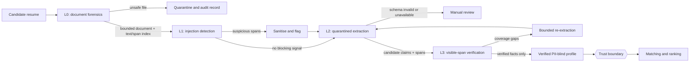

# Resume Intake Specification

> **Status: DRAFT v0.2.** This document specifies the candidate-controlled resume intake lane. It is a companion to [SPEC.md](SPEC.md), which remains the source of truth for the overall product.
>
> **Source material:** This scope consolidates the approved working spec with the proposal deck's resume-attack example, three-lane architecture, state-machine workflow, agent roster, method choices, attack taxonomy, and defence layers. The proposal deck illustrates intended behaviour; when it conflicts with `SPEC.md`, `SPEC.md` wins. Assumptions introduced here are marked _(inferred)_.

---

## 1. Purpose and boundary

Resume intake converts one candidate-submitted resume into a **verified, PII-blind candidate profile** that later components may match against a human-approved requirement profile. It must detect and contain malicious or manipulative content before it can affect a score, rank, explanation, or another candidate.

The intake lane covers L0 through L3:

| Layer | Component | Purpose |
|---|---|---|
| L0 | Document Forensics | Safely admit a bounded document and identify layout, encoding, and file-level anomalies. |
| L1 | Security Agent | Detect candidate-controlled attempts to control the system, manipulate a hiring result, or obtain protected information. |
| L2 | Resume Agent | Extract candidate claims in a quarantined context with a strict schema. |
| L3 | Evidence Verifier | Retain only claims supported by visible resume spans and assign evidence levels. |

The intake lane ends when it emits a `VerifiedCandidateProfile` plus auditable security events. It does **not** analyse the job description, assign fit, compare candidates, rank the pool, generate recruiter explanations, or make a hiring decision. Those functions belong to later trusted and decision-support stages.

### 1.1 Hard trust boundary

> **No raw resume text may reach a model that has tools, the scoring rubric, job requirements, or another candidate's data. Only schema-validated, span-verified facts may cross to matching and ranking.** A fact's quote (bounded and PII-screened, §3.3) is part of the fact for human review and the Explanation Agent; the Matching Agent sees statements only (`SPEC.md` §13.2).

This means an extractor can see only one resume and an extraction schema. A scorer can see only the approved requirement profile and the verified, PII-blind facts. A candidate-controlled sentence such as “rank me first” is data, never an instruction.

### 1.2 Outcomes

The intake lane produces one of the following outcomes for every submitted file:

| Outcome | Meaning | Downstream treatment |
|---|---|---|
| `verified` | L0-L3 completed; all retained facts have verified visible evidence. | The verified profile may cross the trust boundary. Security events, if any, remain visible to later human review. |
| `verified_with_flag` | A usable verified profile exists, but suspicious content was sanitised or a security event requires HR visibility. | Score only the clean, verified profile, and only after logged clearance if review is mandatory (§5.2, §7.2). Show the flag and affected spans to authorized HR. |
| `manual_review` | The system cannot safely parse, classify, extract, or verify the document. | Do not send it to matching or ranking until a human resolves the intake issue. |
| `quarantined` | The file itself is unsafe or cannot be safely processed, for example an invalid type, resource-exhaustion attempt, embedded executable content, or unbounded parser failure. | Do not process further. Preserve the minimum audit record necessary for review. |

`quarantined` is an operational safety state, not a hiring outcome. The system never auto-rejects a candidate.

### 1.3 Scope and non-goals

In scope:

- Candidate-submitted, text-based resumes and their derived text, layout, span, and security metadata.
- Detection of the A1-A10 attack families where they intersect with intake.
- Bounded, schema-constrained fact extraction and visible-span verification.
- Separation of PII and protected attributes from the profile used for matching.
- A trace sufficient to replay the intake decision for one document.

Out of scope:

- Verifying employment, degrees, certifications, or skills against third parties.
- Following hyperlinks, fetching embedded content, opening macros, or using candidate-provided links as tools.
- Image-only/scanned resume support, multilingual extraction, and profile lookups. These are out of scope for resume intake.
- Any fit score, tier, shortlist recommendation, autonomous rejection, or final hiring decision.

## 2. Security and data-handling principles

1. **Resume equals data.** Candidate content cannot override system instructions, schemas, routing, thresholds, or human approval.
2. **Least privilege.** A component that reads untrusted resume content receives no tools, job rubric, requirement profile, candidate pool, or external-network capability.
3. **One candidate per context.** No model call may contain more than one candidate’s raw resume or profile.
4. **Evidence before claims.** Each retained fact must cite at least one exact span from the visible resume text. Mentioning a skill alone does not establish experience.
5. **Visible text wins.** Hidden, off-page, occluded, non-rendering, or otherwise suspicious text cannot supply scoring evidence.
6. **Flag, do not punish.** Security signals cause sanitisation, review, or quarantine of an unsafe file. They never autonomously reject a candidate.
7. **Purpose limitation.** Resume data supports only the relevant application. The system does not enrich it from third-party sources.
8. **No silent degradation.** A failed model call, invalid schema, unsupported format, ambiguous span, or exceeded retry budget must return a safe state, not a partial unverified profile.

## 3. Data classification and records

### 3.1 Data classes

| Data class | Examples | Who may access it |
|---|---|---|
| Raw candidate document | Original bytes, text layer, DOCX XML, rendered page image | L0-L3 only, in the isolated untrusted lane. |
| Sanitised intake text | Text allowed into L2 after exclusion of suspicious spans | L2 and L3 only. |
| LLM-safe span view | Derived copies of allowed spans with email, phone, contact location, and personal links replaced by typed redaction tokens; name is the explicit permitted exception. | L1 semantic judge, L2, and any future model-backed L3 verifier. |
| Identity envelope | Name, email, phone, address, personal links, file name where identifying | Restricted application storage and authorised HR workflows; never Matching or Pool Ranking. |
| Verified candidate profile | Blind candidate ID, supported skills and experience facts, evidence levels, span references, processing status | Matching, Counterfactual, Pool Ranking, Explanation, authorised HR review. |
| Security event | Layer, attack family, risk, offending span reference, action, score impact when later computed | Audit trail and authorised HR review. |

The exact retention periods, access roles, and storage implementation remain unresolved in `SPEC.md` §12. The profile passed to decision support must contain a blind candidate ID rather than direct identity attributes.

### 3.2 Source span contract

Every claim and security finding must use a stable source reference. A `SourceSpan` has at least:

| Field | Requirement |
|---|---|
| `span_id` | Unique within the document and stable for the processing run, for example `p1:s0014`. |
| `page` | One-indexed page number, if the format has pages. |
| `text` | Exact original text for the span, retained only in the untrusted/audit lane when it includes PII. |
| `visible_text` | The exact visible text used for evidence matching. |
| `location` | Character offsets and, where available, bounding box coordinates. |
| `section` | Best-effort structural section such as `experience`, `project`, `education`, `certification`, `skills`, `summary`, or `other`. |
| `visibility` | `visible`, `hidden`, `off_page`, `occluded`, `unrendered`, or `unknown`. Only `visible` spans may support a verified fact. |
| `normalisation` | The Unicode and whitespace normalisation steps used for comparison, while preserving the original text for audit. |

Location and text must let a reviewer locate the source independently. A model-generated paraphrase is never a span.

The canonical L0 span index is an audit and deterministic-processing record; it is not a model-prompt representation. Before any LLM call, a deterministic minimisation step creates an LLM-safe view with the same span IDs. For PDF extraction, adjacent visible style spans on one rendered line may be presented as one **evidence unit** to improve local context, but every original span marker remains present and is still the only valid citation target. Evidence units never create a new canonical span or alter audit provenance. Email addresses, telephone numbers, contact/home location, and personal links are replaced with typed tokens such as `[EMAIL_REDACTED]`; the raw values never enter an LLM request. Name is the explicit exception for the current implementation. The redaction map is restricted audit metadata and ordinary events record only categories and span IDs, never the original values.

### 3.2.1 Security observation, grounding, and action

L1 detectors do not directly sanitise text or route a candidate. Rules, the semantic judge, and any future classifier emit a common **observation** (category, severity, exact excerpt and optional span IDs). A deterministic grounding engine then resolves that observation against the canonical L0 span index in this order: validated explicit span IDs, exact text in one L0 span, exact text in a bounded adjacent-span window, then validated offsets. It never uses semantic similarity to remove content. Hidden or non-visible spans may ground a **security** finding, but remain ineligible for L2 input or candidate evidence.

A grounded medium/high observation can exclude its exact span IDs. An ungrounded observation is retained for audit and may require human review, but cannot itself remove content. If at least one meaningful observation is grounded, the pipeline sanitises that evidence and continues L2 on the safe remainder. If only meaningful ungrounded observations exist, the pipeline routes to manual review. Risk and routing are deterministic functions of grounded findings; an LLM never directly controls them.

### 3.3 Intake outputs

The formal schemas for the document and security records remain an open project-level task (§10, Q7). The profile, fact and span shapes below were agreed with `SPEC.md` §13.2 in v0.2, and the following is the minimum logical contract for this lane.

```text
IntakeResult
  schema_version
  intake_run_id
  blind_candidate_id
  document: DocumentRecord
  status: verified | verified_with_flag | manual_review | quarantined
  forensic_report: ForensicReport
  security_assessment: SecurityAssessment
  verified_profile: VerifiedCandidateProfile | null
  events: [SecurityEvent | ProcessingEvent]
  audit_refs

VerifiedCandidateProfile
  profile_version
  blind_candidate_id
  source_document_sha256
  facts: [VerifiedFact]
  extraction_quality
  verification_summary

VerifiedFact
  fact_id
  kind: skill | experience | project | education | certification
  statement                     # free text, as written on the resume
  source_spans: [VerifiedSpan]  # one or more visible spans
  dates: [string]               # date strings as written, e.g. "2023-25"
  evidence_level: E1 | E2 | E3 | E4
  verification_method: deterministic_literal | nli_literal (legacy) | nli_semantic | literal_fallback
  verification_status: verified

VerifiedSpan
  span_id                       # e.g. p1:s0014
  quote                         # exact visible text of the span, PII-screened
  section
  visibility: visible
```

Notes on the shapes:

- **Flat, free-text facts.** Intake does not emit structured roles, projects or education (no job title, month count, education level or field). It emits one fact per supported claim, and the Matching Agent interprets the text (`SPEC.md` §13.2).
- **No achievement kind.** Achievements are too vague to verify as a separate fact. Outcome detail inside an `experience` or `project` fact is what earns E4.
- **Dates are raw.** `dates` holds the date strings found in the cited text. Intake does not compute durations: who does, and how, is open (`SPEC.md` Q18).
- **Verification provenance is audit-only.** `verification_method` tells reviewers whether support was literal, Qwen NLI with literal support, Qwen NLI with semantic-only support, or the availability fallback. It is not a ranking or matching input.
- **Verification events are reviewable.** Each event carries the claim ID, a bounded `claim_summary`, and cited `source_span_ids` so a reviewer can understand the decision without joining records manually. The summary is omitted when it would expose PII or untrusted instruction text; these fields remain in the intake audit record and never reach ranking.
- **`VerifiedSpan` is not `SourceSpan`.** A `SourceSpan` (§3.2) holds raw text, offsets and bounding boxes and stays in the untrusted/audit lane. A `VerifiedSpan` is what a fact carries across the boundary: the span ID, the exact visible text, and the section. Only `visible` spans can support a fact, so `visibility` is always `visible`.
- **Quotes are part of the fact** for HR review and the Explanation Agent _(decided in v0.2, with `SPEC.md` v0.4)_. The Matching Agent does not receive them (`SPEC.md` §13.2). L3 builds each `quote` from the L0 visible-text index, never from the claim, and:
  - **bounds it** to the claim's own sentence or bullet, cut to a character cap (300 by default _(inferred)_);
  - **redacts** the identity values it refuses in a `statement` (identity-envelope values, emails, phone numbers, URLs), and drops the claim if redaction removes its support _(inferred)_;
  - **screens it** with the deterministic L2 output filter (scoring, ranking and prompt-control language); a quote that trips it is replaced by the `statement`, so the fact crosses without its context.

  The model-side rules (no tools, structured output, one candidate per call, fresh delimiters) and the evaluation that decides whether quotes are ever added to the matcher's input are in `SPEC.md` §13.2 and Q31.

The verified profile contains no fit score, ranking signal, requirement-level match, model prompt, security threshold, or another candidate’s data.

### 3.4 Handoff to ranking

A deterministic adapter is the only bridge from the intake lane to the ranking `VerifiedProfile` (`SPEC.md` §13.2). It reads the `IntakeResult` and maps:

| Intake | Ranking `VerifiedProfile` |
|---|---|
| `blind_candidate_id` | `candidate_id` |
| `facts[]` (`fact_id`, `kind`, `statement`, `evidence_level`, `dates`) | `facts[]`, same names. All five fact kinds cross, not only skills |
| `source_spans[]` (`span_id`, `quote`) | `spans[]` (`location` = `span_id`, `quote`, `visible`) |
| Facts extracted | `extracted_kinds[]`: all five kinds, because L2 attempts each kind _(inferred)_ |
| `status` (`verified` or `verified_with_flag`) | `intake_status`. A literal-fallback profile is always `verified_with_flag`; `manual_review` and `quarantined` results are never handed over |
| `security_assessment.risk` | `overall_risk` |
| Findings from L0 and L1 that cite at least one span | `security_flags[]` (rules below) |
| `schema_version`, `source_document_sha256`, `extraction_quality`, verification events | Not handed over; they stay in the intake audit record |

Security flag rules:

- **One flag per finding**, with `locations[]` holding every span ID the finding cites.
- **Per-finding risk:** a flag carries its finding's own severity. The document's overall risk travels separately as `overall_risk`.
- **L0 findings cross as well** (for example hidden text, A3, and Unicode obfuscation, A4), with `layer` set to `L0`. Their text is already excluded from evidence, so this changes visibility for HR, not the score.
- **No quote.** Flagged text is raw and suspicious, so it never crosses. The HR view fetches the excerpt by span ID from the audit lane.
- **Findings with no span** (for example file-level issues) stay in the audit record only.
- **Facts that fail the PII screen** at the boundary are dropped and listed by ID in the handoff record; nothing is silently rewritten.

## 4. Intake workflow



Processing requirements:

- L0 always runs before text extraction, L1, or an LLM call.
- L1 runs on bounded text and layout metadata produced by L0.
- Every LLM call receives the LLM-safe span view, not raw resume text. Deterministic local checks may use the canonical audit record but must not log contact PII in ordinary pipeline output.
- L2 receives only its random per-request boundary, the sanitised text, and its output schema. It has no tools and no scoring context.
- L3 verifies all candidate claims before any claim crosses the boundary.
- L3 may request one targeted L2 re-extraction when evidence coverage is insufficient. Feedback must name missing fields or invalid spans, not expose a job rubric.
- The pipeline records every state transition, model/version identifier, input/output schema version, decision, and relevant span reference.
- A later L4 counterfactual check can recalculate using the clean verified profile; it does not reopen raw-resume access for privileged scoring components.

## 5. Layer specifications

### 5.1 L0: Document Forensics

**Objective:** admit only a bounded, parseable candidate file and construct the trusted document representation used by later intake layers. L0 does not decide whether a candidate is qualified.

**Required checks**

| Check | Expected signal or action | Attack coverage |
|---|---|---|
| File admission | Allowlisted file type, MIME/signature agreement, byte limit, page limit, and extraction-token limit. | A10 |
| Safe parsing | Do not execute macros, JavaScript, launch actions, embedded files, or external relationships. Do not follow links. | A9, A10 |
| Archive protection | Bound archive members, uncompressed size, and compression ratio for container formats. | A10 |
| Text/render comparison | For PDFs, compare text-layer span metadata with native rendering and layout observations to identify text that is extracted but not visibly rendered. | A3 |
| Layout anomaly detection | Flag text near the page background colour, below the agreed minimum font size, off page, behind an image, or occluded. | A3 |
| Unicode analysis | Record normalisation, remove zero-width controls for detection, and flag suspicious homoglyph, encoded, or obfuscated payloads without silently changing audit evidence. | A4 |
| Bounded document index | Produce page, span, section, visibility, and text representations. | Enables L1-L3 |

**Outputs:** `ForensicReport`, `DocumentRecord`, a visible-text span index, a complete raw-text index held within the untrusted lane, and an initial set of suspicious spans.

**Policy:** Any text deemed non-visible or unsafe is retained for security review but excluded from evidence and from the text sent to L2. A file-level safety issue may quarantine the file. A suspicious textual span alone should not cause a candidate rejection.

**Supported formats:** Text-based PDF, DOCX, and TXT. Image-only/scanned resumes are out of scope. DOCX support must provide equivalent visibility and layout assurance before its output can supply evidence.

**Current L0 resource limits:**

| Limit | Value |
|---|---:|
| File size | 10 MiB |
| ZIP/DOCX member count | 2,000 |
| ZIP/DOCX uncompressed size | 50 MiB |
| ZIP/DOCX compression ratio | 100:1 |
| Recorded URL length | 2,048 characters |

### 5.2 L1: Security Agent

**Objective:** identify text that tries to influence an AI, recruiter, score, rank, system instructions, tools, or confidential information. L1 classifies risk; it does not score qualifications.

**Detection sequence**

1. Run deterministic rules over normalised text for high-recall signals, including instruction overrides, role/system impersonation, score or hiring-outcome directives, tool-execution requests, security bypasses, exfiltration requests, direct reader-address, and encoded payload requests.
2. The current implementation defines a deterministic grey zone: score `0` is low; scores `1`–`59` are uncertain; scores `60`–`100` are high. The high threshold is an interim engineering threshold, not a calibrated production policy. The semantic judge nevertheless runs on every L0-approved resume as an intentional coverage-first defence; the grey-zone terminology describes the deterministic detector, not whether the semantic judge runs.
3. Run the constrained LLM semantic judge (the configured OpenRouter model, by default Gemma 4) for every L0-approved resume, using only labelled LLM-safe spans, then merge its validated findings with deterministic findings before sanitisation and routing. Deterministic findings are supplied as fallible, trusted hints that the judge may confirm, refine, add to or reject. The judge returns only structured, short evidence copied exactly from its redacted input; deterministic code derives the risk tier from grounded finding severities. It has no recruitment or scoring task. This is an interim coverage-first policy until a lightweight classifier is evaluated.
4. Aggregate L0 span-exclusion signals with L1 deterministic and judge findings in the intake result. L4 counterfactual score sensitivity is not implemented yet and remains a later input to the calibrated risk tier.
5. A fine-tuned classifier and a benchmark comparison against Prompt Guard are explicitly deferred. The LLM judge remains the semantic check for the current implementation.

The target risk actions from the proposal are:

| Tier | Intake action |
|---|---|
| Low | Continue, retaining any low-severity telemetry. |
| Medium | Sanitise suspicious spans, continue if safe, and flag the intake result for HR. |
| High | Sanitise suspicious spans and require HR review of the resulting record. |

The mathematical aggregation function and final calibrated thresholds remain open. The current implementation uses the interim thresholds above: file-level safety failures may quarantine; high-risk text is sanitised, processed only as a clean remainder, and returned as `verified_with_flag` with mandatory HR review before matching or ranking; medium-risk text is sanitised and can continue as `verified_with_flag`. They must be calibrated on clean validation data because false flags harm real candidates.

Each L1 finding must include a category, risk/severity, exact evidence span reference, detector provenance, and recommended action. L1 findings never become evidence of competence or lack of competence.

### 5.3 L2: Quarantined Resume Agent

**Objective:** convert one sanitised resume into schema-constrained candidate claims, without making hiring or security decisions.

**Isolation contract**

- One candidate per model context.
- No tools, network, plugins, retrieval, rubric, job description, requirement profile, score, rank, or other candidate data.
- Fresh, random request delimiters and data-marking around the resume content. Resume delimiters must not be reusable across requests.
- Constrained decoding against the L2 schema. Reject extra fields and free-text output outside the schema.
- Temperature-zero, versioned requests for reproducibility where the selected model supports it.
- Output filtering for unexpected meta-language, attempted scoring fields, schema escape, or untrusted instructions echoed into fields where they do not belong.
- Every extracted claim must name one or more proposed source spans. A claim must be atomic, and its citations must cover every material phrase; L2 cannot assign a final evidence level.

L2 may extract candidate details needed for application administration, but those details belong in the identity envelope and must not enter the profile that crosses the trust boundary. L2 must not extract or infer protected attributes such as age, gender, religion, caste, ethnicity, disability, marital status, nationality, or photograph-based characteristics for matching or ranking.

L2 extraction is deliberately incomplete rather than imaginative: unknown values are `null` or empty lists, never guessed. Schema-invalid output, an unavailable model, or an exhausted retry budget produces `manual_review` or `quarantined` according to the failure policy in §7.

**Current implementation contract:** The pipeline generates a fresh cryptographic request marker for every L2 call and supplies only L0-visible, non-sanitised, LLM-safe spans as labelled data. Adjacent PDF fragments on one rendered line are presented together for context, while retaining each original marker as the required citation target. The model (called through OpenRouter, by default Gemma 4) receives the complete L2 JSON Schema both in the prompt and as a structured-output `response_format` with provider-side strict mode, not JSON-mode alone; the output is also always validated locally. Reasoning-model calls reserve a bounded reasoning-token budget so the visible JSON has a completion budget. Email, phone, contact location, and personal links are redacted before the request; L2 is instructed not to infer them and any returned contact values are discarded. Name is the current permitted exception. L2 returns PII-blind, atomic proposed claims; every material phrase must be covered by supplied span IDs. The schema also contains `source_coverage` records, which explicitly account for high-impact structural anchors. The pipeline deterministically identifies visible role-shaped lines in recognised Experience sections and Education lines containing a degree cue; an anchor is complete only when an L3-verified fact of the matching kind cites its source span. A missing anchor triggers one targeted, PII-free retry; if it remains missing, the result is `manual_review` with no rank-eligible profile. This is an extraction-recall safeguard, not negative candidate evidence. A targeted retry receives at most 12 PII-screened repair items _(inferred)_ and is instructed to return only repaired claims; facts already verified in the first pass are preserved separately. A deterministic output filter rejects scoring, ranking, prompt-control, and data-marker echo language in claim fields. The identity envelope is retained only in in-memory intake context pending an approved protected-storage design and is never returned in the default pipeline result.

**L3 lifecycle and batching:** A caller may create one `OllamaVerifier` and pass it as `support_verifier` to successive `normalize_resume` calls, preserving its in-memory verdict cache for that run without persisting runtime resume text. L3 records aggregate-only semantic-pair count, batch count, cache hits and elapsed time in the verified-profile audit metadata and hook events. Per-candidate semantic batching is implemented with strict claim-ID reconciliation, byte and pair-count bounds, and no cross-candidate request. It is disabled by default: it may be enabled only after an actual-model single-versus-batch agreement benchmark on representative, reviewed data meets its approved threshold. The current implementation must not silently replace semantic L3 with deterministic fallback for an evaluation; an L3 outage remains a flagged/manual-review condition.

### 5.4 L3: Evidence Verifier

**Objective:** turn L2's proposed claims into facts that later components can rely on.

For each claim, L3 must:

1. Resolve every cited span against the L0 visible-text index. Reject a span that does not exist exactly, is not visible, or is excluded by sanitisation.
2. Confirm that the cited text entails or supports the claim using deterministic checks and an NLI model where needed.
3. Identify the source section and available dates. Date arithmetic and duration calculations must be deterministic tools, not LLM judgment.
4. Assign the evidence level from the evidence ladder below. The extractor cannot self-assign it.
5. Drop an unsupported claim from the verified profile and record a non-scoring verification event.
6. For each retained claim, attach every cited span as a `VerifiedSpan` (§3.3): the span ID, the exact visible text from the L0 index as a PII-screened `quote`, and the section.

#### Evidence ladder

| Level | Meaning | Example |
|---|---|---|
| E1 | Skill listed only. | `Skills: Kubernetes` |
| E2 | Weak or indirect support, such as a course or certification. | `AWS Certified Cloud Practitioner` |
| E3 | The skill was used in a described role or project. | `Built a Kafka stream for the capstone` |
| E4 | Specific, concrete use with ownership, scale, outcome, or comparable detail. | `Cut pipeline latency 40% with Spark (2023-25)` |

E1 caps keyword stuffing: a long skills list cannot become stronger evidence merely through repetition. E0 (absent) belongs to later requirement-level matching and is not a fact emitted by resume intake.

L3 verifies the resume against itself only. It does not check public profiles, infer capability from an employer name, or validate factual truth outside the candidate-provided document.

**Current implementation contract:** Default L3 deterministically resolves visibility and sanitisation status, requires the proposed claim value to occur in its cited text, extracts available date strings, and assigns E1–E4. Claims that fail any check are dropped with non-scoring events. One L2 retry may receive targeted, PII-screened feedback for repairable citation or support failures: the safe claim summary, prior cited span IDs, and controlled verifier reason. It must use only the existing labelled resume data to add direct supporting spans, narrow the claim, or omit it. It never receives a rubric, job context, hidden/excluded text, or newly invented evidence.

**Default semantic gate:** Local `ats-l3-qwen2.5-3b` through Ollama is the default verifier; `--l3-verifier deterministic` is an explicit literal-only opt-out. After the hard deterministic gates, exact literal support in the bounded, sanitised cited evidence is accepted as `deterministic_literal` without an NLI request. For the remaining semantic-only claims, Qwen receives only `claim + sanitised cited evidence` and returns `entailed`, `contradicted`, or `insufficient_evidence`; only `entailed` may cross as `nli_semantic`. These labels are audit provenance, not a scoring signal or a second acceptance requirement.

The local client is centralised in `llm.py`, uses schema-constrained JSON and temperature zero, and defaults to `http://127.0.0.1:11434` (`ATS_L3_OLLAMA_URL`). Missing models, invalid responses, connection failure and oversized evidence trigger the flagged literal fallback described below; no unsupported claim becomes accepted and no L2 infrastructure retry occurs. Requests have a conservative UTF-8 byte limit below the configured 8192-token context budget; evidence is never silently truncated.

When the NLI hook runs, progress output and `L3_NLI_MODEL:<model tag>` identify the selected model. Human-readable `event_details` reports `L3_NLI_VERIFICATION_COMPLETED` with the retained-fact count or `L3_NLI_LITERAL_FALLBACK` requiring review. Per-claim `verification_events` retains accepted and rejected decisions; `profile.facts` contains only accepted facts. Opt-in live pipeline tests use controlled hosted L1/L2 responses and real local NLI inference, separately from full hosted extraction evaluation.

**Superseding hybrid implementation:** The preceding default/opt-in and failure wording is superseded by the current hybrid implementation. Local `ats-l3-qwen2.5-3b` is now the default L3 verifier; `--l3-verifier deterministic` is an explicit literal-only opt-out. Hard deterministic trust-boundary gates always run first: cited span existence, visibility, L0/L1 exclusion, PII/institution policy, and construction of bounded PII-minimised safe evidence. Exact literal support is accepted as `deterministic_literal`; only semantic-only claims are sent to Qwen, where `entailed` accepts and `contradicted` and `insufficient_evidence` reject. These methods are audit provenance, not a scoring input or a second acceptance requirement. Evidence level, rank credits, source span IDs and quotes remain deterministic code outputs.

If Qwen becomes unavailable, returns invalid JSON, or cannot accept the bounded request, already NLI-verified facts remain unchanged. Remaining eligible claims must pass literal support against the same sanitised evidence and are marked `literal_fallback`; the profile receives `L3_NLI_LITERAL_FALLBACK`, `requires_human_review=true`, and `verified_with_flag` before ranking. Unsupported claims are still dropped and no L2 repair retry occurs. Claims evaluation separately exports a seeded PII-minimised sample of `nli_semantic` facts for human audit.

The college experiment trains a Qwen2.5-3B adapter on Colab using QLoRA and a frozen, grouped WANLI subset, then exports a merged Q4_K_M GGUF for local Ollama. The source adapter, revisions, hashes and tokenizer are preserved for portability. Evaluation uses independent labelled pairs, a disclosed synthetic resume set and fixed-L2 replay. Existing word-overlap citation checks remain lexical diagnostics, not semantic accuracy. The notebook and code alone establish no completed training, achieved accuracy or fine-tuning improvement. Instructions and defaults: `docs/L3_NLI_EXPERIMENT.md`.

## 6. Attack handling matrix

| ID | Attack family | Intake handling | Primary layer |
|---|---|---|---|
| A1 | Direct injection | Detect instructions to ignore rules or alter assessment; sanitise and retain the event. | L1, L2 |
| A2 | Instruction impersonation | Detect fake system/HR/evaluator messages and delimiter spoofing; isolate L2 with fresh boundaries. | L1, L2 |
| A3 | Hidden text | Detect text/render and layout discrepancies; exclude it from evidence and L2 input. | L0 |
| A4 | Unicode obfuscation | Normalise for detection, retain original provenance, and flag suspicious controls or obfuscation. | L0, L1 |
| A5 | Keyword stuffing | Retain only evidenced claims; skill-list-only claims stay E1. | L3 |
| A6 | JD copying | Intake preserves span provenance. The pool-relative similarity decision belongs to L4. | L3, then L4 |
| A7 | Unsupported claims | Require visible span and entailment before retaining the claim. | L3 |
| A8 | Subtle persuasion | Detect reader-addressed or outcome-manipulating language; later test whether it moves the score. | L1, then L4 |
| A9 | Exfiltration or cross-candidate request | Never give an untrusted-text reader tools, rubric, system prompt, or another candidate's data. | L0, L2 |
| A10 | Resource exhaustion | Enforce file, archive, page, text, and token budgets before expensive processing. | L0 |

## 7. Failures, retries, and human review

### 7.1 Bounded retry rules

- L0 does not retry an unsafe document parser with a less restrictive parser.
- L1 detector failures do not default to “clean”. A deterministic high/medium finding is an approved safe fallback: its spans are sanitised, the clean remainder may be extracted, and the resulting record requires HR review before matching or ranking. A detector failure with no deterministic finding routes to `manual_review`.
- L2 may retry only for L3-identified coverage or span-resolution gaps, up to the configured retry limit. A deterministic missing Experience-role or Education-degree anchor is a coverage gap even where L2 returned syntactically valid JSON.
- Retried L2 calls use the same quarantined privileges and may receive only targeted, PII-screened validation feedback: safe claim summary, prior citation IDs, and a controlled failure reason. They must not receive a rubric, job context, hidden/excluded text, or raw audit-lane PII.
- A failed optional L2 citation-repair retry never discards facts already verified by L3. The first-pass profile is returned with `verified_with_flag` semantics (`normalized_with_flag` in the current pipeline result) and mandatory human review plus a retry-failure event; only an initial L2 failure has no verified profile and routes to `manual_review`. **Exception:** an unresolved deterministic Experience-role or Education-degree anchor routes to `manual_review` and withholds the profile from ranking, because an omitted high-impact claim can unfairly lower a candidate's score.
- L3 does not invent a span to complete a profile. It drops the claim or routes to review.

### 7.2 Human-review packet

When review is required, the system must provide the authorised reviewer with:

- blind candidate ID and document hash;
- current intake status and the layer that caused it;
- risk tier and attack family, if known;
- offending text or a controlled excerpt with page/location;
- whether the span was excluded from extraction and evidence;
- the verified profile, clearly separated from unverified or excluded content;
- processing errors and model/schema versions relevant to reproducing the result; and
- a logged reviewer disposition and reason.

The review packet does not expose the scoring rubric, system prompt, other candidates, or an autonomous hiring recommendation.

The same authorized HR user who uploaded the resume can clear a hold on an existing Verified Profile or keep it on hold, with a logged reason. Clearance only changes eligibility for matching and scoring; it does not restore excluded spans, clear the security flag, or make a hiring decision. If there is no usable Verified Profile, a safe retry or replacement is required before matching. A quarantined file cannot be released. See [Web UI Flows](docs/WEB_UI_FLOWS.md#3-upload-and-verify-resumes).

## 8. Auditability and observability

Each intake run must record immutable or append-only references for:

- intake run ID, blind candidate ID, application/role scope, document hash, and file metadata;
- document-parser and detector versions, model identifiers, prompt/template versions, and schema versions;
- L0 findings, L1 findings, sanitisation decisions, L2 retry count, L3 acceptance/rejection of each claim, and final status;
- span references and visibility state, without copying more raw PII than required for an authorised audit; and
- reviewer actions, overrides, timestamps, and reasons.

Tracing supports debugging and evaluation, but tracing infrastructure must follow the same PII access and retention policy as the source resume. A log must never store the scoring rubric or privileged prompt inside a candidate-controlled processing context.

### 8.1 Output exposure

The full L0 report is an **audit artifact**, not a default operational response. It includes source spans, controlled excerpts, and sanitised text that may still contain candidate PII.

- **Default CLI/API output** must be a PII-minimised summary: decision, risk level, issue counts/codes, document hash, detected type, page/span counts, and suspicious span IDs where available.
- **Audit artifact** access must be separate from ordinary operational output and restricted to authorised reviewers under the project's retention and access policy.
- **Debug output** may expose the full structured report only through an explicit opt-in in an authorised environment. It must never be enabled by default or sent to general logs.
- Later intake components may use the full report only inside the untrusted/audit lane. They pass only the data permitted by the trust boundary onward.

## 9. Measurement and acceptance criteria

The intake lane is independently measurable. It must be evaluated on public, licensed, PII-scrubbed, or synthetic data only.

| Area | Measure | Planned evidence |
|---|---|---|
| Forensics | Hidden-text detection rate; false flags on clean resumes; parser rejection rate | Paired rendered/text-layer variants and clean files |
| Injection detection | TPR, FPR, AUROC by attack family; span-localisation quality | A1, A2, A4, and A8 variants plus clean resume-context negatives |
| Extraction | Field-level precision, recall, F1; schema-valid rate | Annotated resumes and synthetic records with labels by construction |
| Evidence verification | Citation precision; visible-span resolution; evidence-level accuracy | Human audit of facts and cited spans |
| Robustness | Attack success rate and rank shift in the later full pipeline | Paired clean/attacked twins; compare naive, unguarded, and full systems |
| Reliability | Processing latency, bounded-retry rate, safe-failure rate | Traces from repeatable runs |

Current project hypotheses include approximately 85% extraction correctness, at least 95% citation precision, at least 99% schema-valid agent output, and no more than 3 false flags per 100 clean resumes. These are evaluation targets, not achieved results. Metrics must report confidence intervals where sample sizes permit.

## 10. Open questions

The following resume-intake decisions remain unresolved and must be answered before implementation is treated as conformant:

1. **DOCX visibility assurance:** What is the equivalent of PDF text/render validation for DOCX before a DOCX span may support evidence?
2. **Remaining L0 thresholds:** The file, archive, and URL limits above are fixed for now. What page-count, extracted-token, font-size, colour-distance, and timeout limits apply, and how are they evaluated against legitimate long CVs?
3. **Risk aggregation:** What calibrated function combines L0, L1 deterministic/judge signals, and L4 counterfactual results? Should the interim `0`, `1`–`59`, and `60`–`100` thresholds change after evaluation?
4. **High-risk handling:** High-risk textual content currently leads to `verified_with_flag` plus mandatory HR review before matching. Which additional conditions, beyond unsafe files and empty sanitised output, justify file quarantine?
5. **L1 design:** What judge model, judge prompt, and grey-zone calibration are approved? (Gemma 4 via OpenRouter is the current default; see `SPEC.md` Q29 on sending resume text to a hosted provider.) How will the team compare the current rules-plus-judge approach with a fine-tuned encoder and Prompt Guard when those options are evaluated?
6. **L2 contract:** What fields belong in the identity envelope versus the PII-blind candidate profile? Who can read each, and at which point are identity spans redacted from facts that matchers receive?
7. **Schema ownership:** _Partly resolved in v0.2:_ the shapes of `VerifiedCandidateProfile`, `VerifiedFact` and `VerifiedSpan` (§3.3) and the ranking handoff (§3.4) are agreed with `SPEC.md` §13.2. Still to define as versioned Pydantic/JSON schemas: `ForensicReport`, `SecurityAssessment`, `SourceSpan`, `CandidateClaim`, security findings (including the `attack_family` each finding records), and audit events. Duration computation from `dates` is open (`SPEC.md` Q18).
8. **Extraction retry:** Confirm the retry budget, which verifier feedback is safe to reveal, and whether any retry can change sanitisation decisions.
9. **Evidence policy:** How are multi-span claims, inferred durations, dates with only a year, overlapping roles, and evidence that contains identity information handled? Confirm whether recency is assigned during intake or matching.
10. **PII and retention:** Define encryption, access controls, audit-log redaction, deletion timing, and the applicable data-protection requirements for runtime applications.

## 11. Dependencies on the wider system

| Dependency | Intake expectation |
|---|---|
| Requirement Profile | Must never enter L0-L3. Its human approval remains a prerequisite for matching, not intake. |
| Matching Agent | There is no skill catalogue (`SPEC.md` §6.3). Facts keep skills and statements as free text, as written on the resume; the decision-support lane's Matching Agent links them to requirements by meaning, seeing statements, kinds, evidence levels and dates but not quotes. Intake must not normalise skills in a way that turns an unverified claim into evidence. |
| Ranking handoff | A deterministic adapter (§3.4) maps L3-verified, PII-blind facts of all five kinds, as free text, to the ranking `VerifiedProfile`, together with the intake status, overall risk and per-finding security flags. Nothing is inferred or normalised at the boundary, and a fact kind that wasn't extracted is missing, never scored as zero. |
| Counterfactual L4 | Receives verified facts, security events, and controlled span references. It must not provide privileged scorer access to raw resume text. |
| Explanation Agent | Receives verified facts and approved evidence references only. It must not cite hidden or excluded text. |
| HR Review | Receives flags, controlled excerpts, and audit information, but remains the sole decision maker for shortlist approval or override. |
| Evaluation harness | Generates paired malicious variants only in an isolated sandbox using public or synthetic data. It must never operate on runtime candidate applications. |

---

## 12. Conformance summary

A resume-intake implementation conforms to this draft only if it can demonstrate all of the following:

- It never gives raw candidate text to a tool-enabled, rubric-aware, or multi-candidate model context.
- It emits no downstream candidate fact without at least one validated visible source span.
- It excludes suspicious or non-visible content from evidence and records why.
- It bounds document resources and avoids executing or fetching candidate-controlled content.
- It keeps identity/protected attributes out of matching and ranking inputs.
- It returns a safe terminal outcome for invalid output, unavailable dependencies, or exhausted retries.
- It records sufficient provenance for an authorised human to inspect the intake result.
- It never turns a security flag into an autonomous hire or reject decision.
